# Ralph

A global CLI and TypeScript library for goal-driven Codex or Claude iterations. Ralph ranks
five proposed improvements, implements one, runs checks and browser verification,
reviews the changes, and commits each verified iteration on a local branch.

## How it works



Throughout the loop, Ralph appends decisions and results to `progress.txt` and
saves logs and checkpoints in `.ralph/`. Failed baseline checks, exhausted repair
attempts, or interruptions stop the run with changes preserved for resuming.

## Install globally from npm

```sh
npm install --global @muthuspark/ralph
ralph --help
ralph --version
```

To build and install from a local checkout, use the steps below.

Requires Node.js 22+, npm, Git, and an authenticated `codex` or `claude` executable on `PATH`.

Install from GitHub:

```sh
git clone https://github.com/muthuspark/ralph.git
cd ralph
npm install
npm pack
npm install --global ./ralph-*.tgz
ralph --help
```

From this package directory:

```sh
npm install
npm link
ralph --help
```

For an independent installation you can distribute without the source directory:

```sh
npm pack
npm install --global ./muthuspark-ralph-1.0.1.tgz
```

`npm link` follows this checkout; rebuild with `npm run build` after changing the source.

## Run in a project

Ralph operates on the Git repository containing your current directory. It stores
`progress.txt` and `.ralph/` at that repository's root, independently for each project.

Before the first run:

- Add `.ralph/` to the project's `.gitignore` and commit it.
- Commit existing changes. Ralph requires a clean tree and an initial Git commit.

For Node projects, provide working `lint`, `typecheck`, `test`, and `build` npm
scripts. Browser verification is enabled by default: install `@playwright/test`
and Chromium in the project and start the app separately using test-owned data.
Ralph uses the project's Playwright installation for browser verification, including
when Ralph itself is installed globally. If it is missing, install it with
`npm install --save-dev @playwright/test` and run `npx playwright install chromium`.

For Python projects with `pyproject.toml` and no `package.json`, Ralph checks
Python syntax and runs unittest tests. It uses `uv run --locked python` when a
`uv.lock` exists, otherwise `python3`. Projects declaring pytest use pytest
instead. Python projects default to browser verification disabled. If no tests
exist, baseline records that limitation; implementation must add tests before
verification and commit. Python bytecode caches live under `.ralph/pycache/`.

For other projects, mixed repositories, CLI-only Node projects, or custom checks,
add and commit `ralph.config.json` before starting a run:

```json
{
  "checks": [
    { "name": "test", "command": ["uv", "run", "--locked", "python", "-m", "unittest", "discover", "-s", "tests"] }
  ],
  "browser": false
}
```

Commands are executable/argument arrays, run from the target repository root
without a shell. Every command must pass; use real checks appropriate to the
project. Explicit configuration overrides automatic detection. Agents are
instructed not to change check configuration. To change it during a stopped run,
use `--retry-verification` to accept and fully verify the current edits.

```sh
cd /path/to/project
ralph --goal "Improve onboarding" --iterations 3 --base-url http://localhost:3000
ralph --goal "Improve onboarding" --agent claude --iterations 3
ralph --goal-file requirements.txt --iterations 1
ralph --resume <run-id>
```

The default limit is ten verified commits; `--iterations 0` runs without a limit.
When browser verification is enabled, the app must remain available at `--base-url`
(default `http://localhost:3000`).
Ralph uses its bundled Playwright runner and configuration; the project does not
need a `test:e2e:ralph` npm script or a `playwright.ralph.config.ts` file.
Generated specs live under `e2e/ralph/<run-id>/` in the project.

Ralph creates a `ralph/<run-id>` branch and commits verified changes automatically.
It never pushes, merges, or deploys. Codex calls may incur usage charges.

## Progress and recovery

`progress.txt` is an append-only, timestamped record of phases, ranked candidates,
implementation decisions, check results, repairs, and stop/resume instructions.
It is created automatically when a run starts and included in verified commits.
Watch it from another terminal:

```sh
tail -f progress.txt
```

Detailed command logs, prompts, browser reports, and resumable checkpoints are
stored in `.ralph/<run-id>/`. Ctrl+C preserves unfinished changes and records the
resume command. Resume from the same branch and working tree. After manually
fixing an unfinished increment, use:

```sh
ralph --resume <run-id> --retry-verification
```

This accepts the current edits for full verification and preserves the repair
count. `ralph --help` lists the remaining options.

## Library

The package exports ESM functions and TypeScript declarations:

```ts
import { parseOptions, runRalph } from "@muthuspark/ralph";

const options = parseOptions(["--goal", "Improve onboarding", "--iterations", "1"]);
await runRalph(options, "/absolute/path/to/project");
```

Install the package as a dependency to import it; a global command installation
does not make the package available to Node imports in unrelated projects.
`runRalph` accepts an optional third `AbortSignal` argument. Browser report
validation is exported from `@muthuspark/ralph/browser`.

## Development

```sh
npm run lint
npm run typecheck
npm test
npm run build
```
